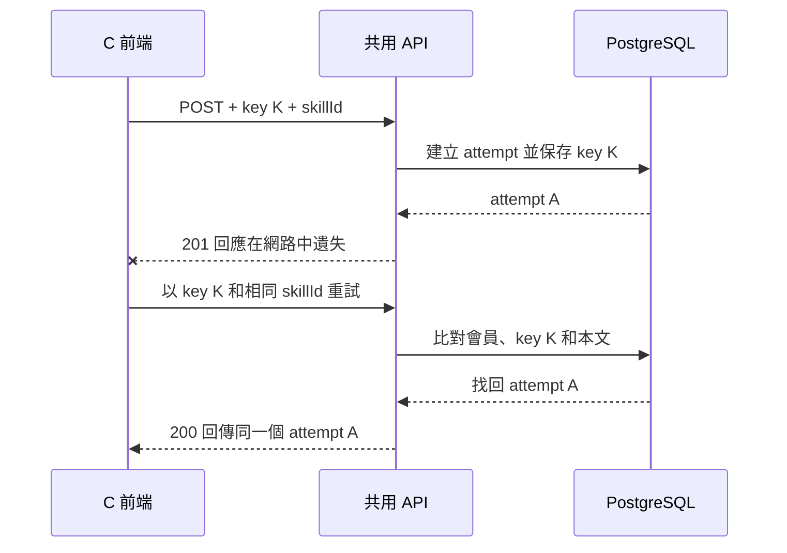

# 測驗建立的 Idempotency-Key 使用說明

## 它是什麼？

`Idempotency-Key` 是前端替「這一次建立測驗」產生的唯一請求 ID。**冪等的意思是：同一個動作重送多次，後端仍只建立一次。**它不是登入憑證，也不放在 JSON body 裡；它是 HTTP header，用來讓後端辨認某個建立請求是不是同一個操作的重送。C PR #93 目前提供建立 router；E migration 和共用 CORS 支援在 E integration PR，兩邊尚未完成 live DB 整合。

例如會員按下「開始測驗」後，瀏覽器可能送出請求，但網路在回應到達前中斷。前端不知道測驗有沒有建立。若直接再送一次並換一個 ID，後端會把它當成新的開始操作。若沿用原本的 ID 和相同本文，後端會找回第一次建立的 attempt，不會再抽一組題目或新增第二筆。



## 前端如何使用

1. 會員開始一個新的測驗操作時，用 `createQuizIdempotencyKey()` 產生一個 UUID。
2. 呼叫 `startQuizAttempt(skillId, key)`，把 key 放在 `Idempotency-Key` header，本文只放 `{ "skillId": "..." }`。
3. 如果網路逾時、連線中斷，或無法確定第一次是否成功，使用同一個 key 和完全相同的本文重試。
4. 收到成功回應後，記住回傳的 `attemptId`，並結束這次建立操作。會員之後明確開始另一場測驗時，再產生新的 key。

```js
import { createQuizIdempotencyKey, startQuizAttempt } from "./services/quizzes.js";

const key = createQuizIdempotencyKey(); // 一次新的「開始測驗」操作只產生一次
const createRequest = () => startQuizAttempt(skillId, key);

try {
  const attempt = await createRequest();
  // 保存 attempt.attemptId，接著顯示這場測驗
} catch (error) {
  // 若結果不確定，讓使用者用同一個 createRequest() 重試；不要重新產生 key。
}
```

程式中的 `key` 要保留到這次請求結果確定為止。重試必須同時沿用 key 和 `skillId`。只把 key 留在目前的建立流程狀態中即可；它不是秘密資料，不應被當成 session 或登入 token。

## 後端如何處理

| 情況 | 結果 |
| --- | --- |
| 第一次收到有效 key 和本文 | 建立一筆 attempt，回 `201`。 |
| 相同會員用相同 key、相同本文重試 | 回第一次建立的同一筆 attempt 和同一份題目快照，回 `200`。 |
| 相同會員並行送出相同 key、相同本文 | 建立一筆 attempt；並行回應指向同一個 attempt（建立回應為 `201`，重送回應為 `200`）。 |
| 相同會員用相同 key，但 `skillId` 不同 | C PR #93 回 `409 IDEMPOTENCY_KEY_CONFLICT`；不能把舊 key 改作另一個建立請求。 |
| 缺少 key、格式不是 UUID | 回 `400` 驗證錯誤。 |
| key 對應的 attempt 後來已取消 | 相同 key 重送會回原 attempt、`200` 且 `status: "cancelled"`，不會重開或建立第二筆。讀取已取消 attempt 則回 `404 ATTEMPT_NOT_FOUND`。 |

key 的作用範圍是 `(登入會員, key)`，目前不設到期時間，並隨 attempt 保存。後端會對本文計算 fingerprint，確認同一 key 重送的 `skillId` 沒有改變。相同 key 的查重只套用在 `POST /api/quizzes/attempts`，不取代會員 session，也不套用到讀取或答案提交 API。

## 快速判斷

- **重送同一次操作：**相同 key + 相同 `skillId`。
- **開始另一場測驗：**新 key + 要測驗的 `skillId`。
- **收到 `IDEMPOTENCY_KEY_CONFLICT`：**程式把舊 key 配給不同本文；檢查前端是否在重試時改了 `skillId` 或錯誤共用了 key。
- **拿到 `status: "cancelled"`：**該 key 對應的舊 attempt 已取消；要重新開始時建立新 key。

取消規則的目前實作是：新建同會員、同技能測驗時，將舊的 `in_progress` attempt 標記為 `cancelled`，並保留舊資料列和 key；取消與新 attempt 建立在同一資料庫 transaction。這個取消範圍列在 PR review 項目中，請 C 確認是否符合產品流程。
