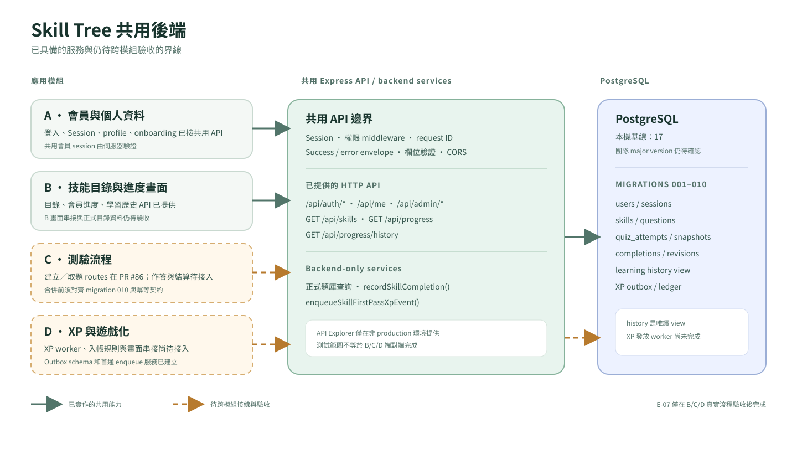

# A–D 後端串接指南

這些指南的目的，是讓各模組能先用穩定的 API 與 E 共用服務開發前端／route，不必猜資料表或直接改共用資料庫。**Browser client 一律呼叫 HTTP API；只有受信任的 backend route 才能在 transaction 中呼叫內部 service。**

| 模組 | 指南 | 從哪裡開始 |
| --- | --- | --- |
| A | [會員登入、註冊與個人資料](a-member-auth-profile.md) | 註冊、登入、profile、忘記密碼與 admin member API |
| B | [技能目錄、進度與學習地圖](b-skill-catalog-progress.md) | `skillId`、catalog version、解鎖資料和歷史游標 |
| C | [測驗 API、冪等與結算橋接](c-quiz-and-completion.md) | 開始測驗、讀題、答案契約、永久通過與待完成項目 |
| D | [XP Outbox、帳本與歷史橋接](d-xp-history.md) | Outbox event、worker lease、XP ledger 和歷史 API |

## 共同開發流程

1. 先確認大家切在同一個 branch/commit，依 [後端與資料庫上手指南](../backend-onboarding.md)準備自己的 PostgreSQL 測試資料庫。
2. 讀相應模組指南和[API 契約](../api-contract.md)。API request/response 以 `backend/openapi.json` 為機器可讀來源；欄位限制以 `backend/migrations/*.sql` 和契約說明為準。
3. 前端共用 `src/services/api.js` 的 `apiRequest()`，保留 cookie credentials 和標準錯誤 envelope；不在瀏覽器連資料庫、不傳 `userId` 代表登入身份。
4. Schema 變更新增遞增 migration，不修改已提交 migration。請求其他組員同意前先把欄位或流程寫進 API 契約，避免兩個模組各自建相同資料。
5. 先做本機 API Explorer/工作台檢查，再用隔離 `TEST_DATABASE_URL` 做資料庫驗收。Mock、前端畫面和 API shape smoke check 都不能取代 DB 整合結果。

## 共用邊界圖

### 問題先定位

| 看到的狀況 | 檢查位置 |
| --- | --- |
| API 回 401 | 登入狀態和 `sid`／`admin_sid` cookie；確認 `apiRequest()` 有 credentials |
| `DATABASE_UNAVAILABLE` | 本機 PostgreSQL、`DATABASE_URL`、migration 是否跑完 |
| 缺少欄位或 migration checksum 不同 | Git 分支 SHA 與 migration 版本；不要改舊 migration |
| 前端欄位對不上 | `docs/api-contract.md`、OpenAPI schema 和對應模組 adapter |
| 功能依賴尚未存在的 route | 指南標示「待實作」；先做 mock adapter，向 route owner 對齊契約，不假裝 API 已可用 |
