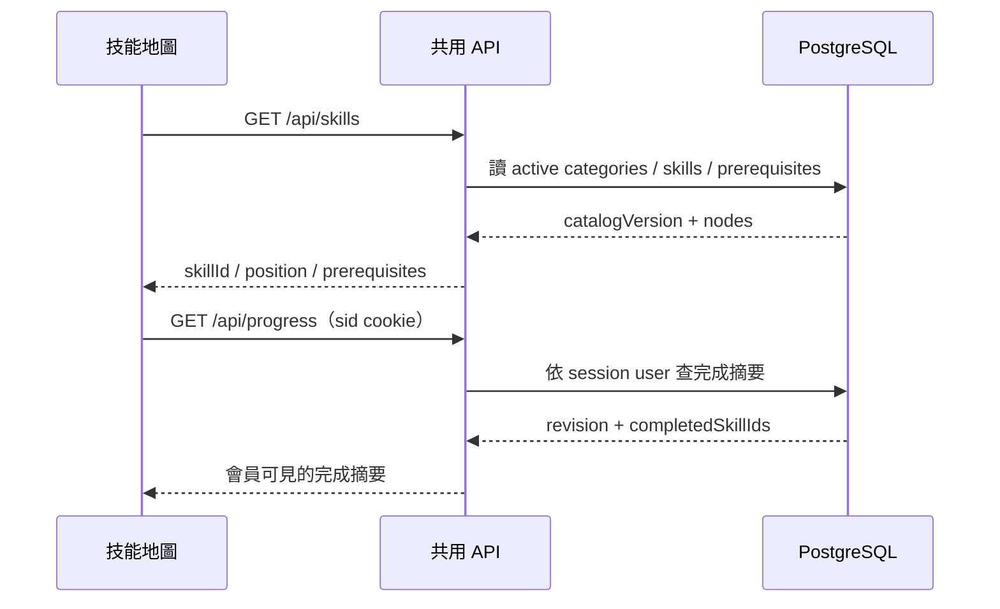

# B｜技能目錄、進度與學習地圖

E 提供技能目錄和會員進度的資料來源；B 負責節點呈現、解鎖規則和互動。前端只使用 API 回傳的 `skillId`，不要用 title 或節點陣列位置當識別碼。

## 目前遠端頁面狀態

截至 2026-11-28，PR #90 已合併；此 E integration candidate 的 root `src/App.jsx` 將 `/skillmap` 指向 `src/page/skill-map/SkillMapPage.jsx`。新版頁面仍使用本機示範進度和內建 `data/skills.js`，尚未改接 E 的 `GET /api/skills`、會員進度與 `quiz-availability` API；B PR #84 仍開啟，實際整合前請對照最新分支。

E 的正式 API 在 E 整合候選分支，並非目前遠端 `main` 已經可用的服務。要測 E API，A–E 組員必須先切到同一個 E PR head SHA，並在自己的本機 DB 套用該分支 migrations。

## 讀取資料

### 技能目錄

`GET /api/skills` 是公開唯讀 API，回傳 `{catalogVersion,categories,skills}`。每個技能包含 `skillId`、`categoryId`、title、description、learningItems、position、sortOrder 及 `prerequisiteSkillIds`。`catalogVersion` 表示這份 active catalog 的版本。

### 會員進度

`GET /api/progress` 需會員 `sid`，回傳 `{catalogVersion,revision,completedSkillIds}`。`revision` 是字串，初始為 `"0"`；`completedSkillIds` 使用目錄相同的 `skillId`。E 不提供瀏覽器可任意寫完成狀態的 endpoint。

### 活動歷史

`GET /api/progress/history?skillId=html-basics&limit=10` 需會員 `sid`。目前只列完成測驗；回傳 `{items,nextCursor}`。載入更多時帶上相同篩選的 `skillId` 和回傳的 `nextCursor`：

```js
const first = await apiRequest("/progress/history?skillId=html-basics&limit=10");
if (first.nextCursor) {
  const next = await apiRequest(
    `/progress/history?skillId=html-basics&limit=10&cursor=${encodeURIComponent(first.nextCursor)}`
  );
}
```

游標綁定原始技能篩選；換 `skillId` 後必須重新從第一頁查詢。空歷史是 `items: []`，不代表 API 失敗。`catalogVersion` 不要拿來替換 `skillId`。

## 建議的前端資料流程



B 可以在前端依先修關係呈現 locked/current/completed，但完成資格的權威資料是 `completedSkillIds`。只有測驗真正通過後，由 C 的受信任 backend route 呼叫 E 的完成 service 更新進度；不要直接在瀏覽器 localStorage 或 API request 假造完成狀態。

## 資料庫與尚待提供內容

- `skill_categories`、`skills`、`skill_prerequisites` 為共享目錄資料。B 提供正式 `skillId`、分類、排序、位置、教材欄位和版本；E 維護 migration 與讀 API。
- C 的測驗建立會用 `skillId` 查 active 節點和先修資格；正式測驗還會檢查五題 C 相容題庫。題庫檢查不取代 B 的教材 readiness 決定。
- 現在 `GET /api/skills` 不回傳每技能測驗 ready 狀態；五個 MVP IDs 和 ready flag 尚待 B/C 對齊。不要在 client 自行推算 ready 後向使用者承諾測驗可開。
- B 的 PR #84 與 E worktree 曾修改同一個 demo map App；先對照最新 `main` 和 PR #84 變更，再整合唯讀 `/demo`，避免覆寫 B 的地圖互動。

## B 需要協助確認／交付的項目

1. 提供正式目錄 JSON／seed 資料和 stable `skillId`，確認 `catalogVersion` 更新方式。
2. 確認 `position`、learningItems 和 prerequisite 欄位可支援正式地圖畫面；若缺欄位，先開 API/schema contract change。
3. 把 B 的 map adapter 接到 `/api/skills`、`/api/progress`；真實會員情境再接 `/api/progress/history`。
4. 以一位測試會員驗證完成節點顯示、先修鎖定、沒有歷史的空狀態和會員登出後 401 狀態。
