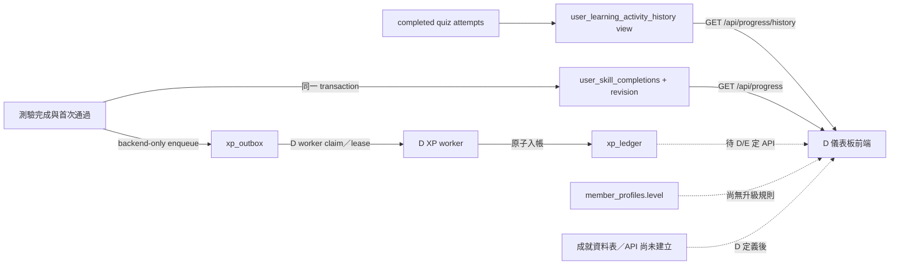

# D｜XP 發放、資料庫與歷史 API 串接指南

這份指南讓 D 可以開始做 XP 消費和畫面串接，不需要自行猜資料表或建立重複的學習歷史。使用個人本機 PostgreSQL；D worker 以 lease 領取並更新共用 Outbox，依 D 確認的規則發獎，再寫入共用 ledger。

## 先分清楚目前有哪些接口

| 需要的功能 | 目前提供什麼 | 狀態／負責人 |
| --- | --- | --- |
| C 首次通過時產生 XP event | `enqueueSkillFirstPassXpEvent(database, { userId, skillId, attemptId })`，位於 `backend/src/services/xp-outbox.js` | E 已提供；C 必須在測驗完成、永久進度更新的同一個 transaction 呼叫 |
| D 消費 event、套用獎勵規則、寫 ledger | `xp_outbox`、`xp_ledger` 與 lease 欄位 | Schema 已有；D 實作 worker 的 claim／ack／fail、獎勵政策和排程 |
| 會員學習歷史 | `GET /api/progress/history?limit=20&cursor=...&skillId=...` | E 共用唯讀 API 已接好；D 可直接串 UI |
| 會員 XP／等級摘要 API | 目前沒有一般會員可呼叫的 XP summary endpoint | D 先提供畫面需要欄位及回應草案，再請 E 加 API 契約與 route；不要用管理員 API 代替 |
| XP worker HTTP API | 目前沒有，也不應公開 Outbox／ledger 寫入路由 | D worker 是可信任的 server-side process，不從瀏覽器呼叫、不經 API Explorer 發獎 |

這些是程式與本地工作分支狀態，不表示已在共用部署或團隊資料庫上完成端對端驗收。與 E 整合前，先確認使用相同 PR head SHA 和已套用 migrations。

## P2-D-01～07 對照：資料庫、可用 API 與缺口

| Issue | 可用資料來源 | 目前 API／處理方式 | 尚需完成或確認 |
| --- | --- | --- | --- |
| [P2-D-01 XP 事件與發放](https://github.com/Coding-Skill-Tree/Skill-Tree/issues/64) | `xp_outbox`、`xp_ledger` | E 的 producer 只建立 event；D worker 需以 server-side DB service 消費，不是 HTTP endpoint | issue 已勾選獎勵計算、XP 加總／紀錄等項目，但本工作樹沒有 D worker；接收、去重、claim、lease、ack/fail、退避仍須以 D 實際 PR/程式驗證，不能以 issue 勾選當成已整合 |
| [P2-D-02 等級](https://github.com/Coding-Skill-Tree/Skill-Tree/issues/65) | `member_profiles.level` 已存在，預設 1；XP 總額可由 `xp_ledger` 加總 | 沒有會員等級／升級 API | 等級門檻和升級規則屬 D；決定等級是每次由 XP 推導，或由 D 在入帳時更新，並與既有 `level` 欄位一致 |
| [P2-D-03 學習紀錄](https://github.com/Coding-Skill-Tree/Skill-Tree/issues/66) | 唯讀 view `user_learning_activity_history` | `GET /api/progress/history` 已可查本人完成的測驗活動 | 目前來源只有完成的 quiz attempt；不複製 C 的測驗資料，也不包含 XP 入帳明細 |
| [P2-D-04 分類進度](https://github.com/Coding-Skill-Tree/Skill-Tree/issues/67) | `skill_categories`、`skills`、`user_skill_completions`、`user_progress_revisions` | `GET /api/skills` + `GET /api/progress` 可組合計算 | 分母應採啟用分類中的啟用技能；需和 B 核對目錄版本及排除規則。可由 D 聚合，或納入 dashboard API |
| [P2-D-05 成就](https://github.com/Coding-Skill-Tree/Skill-Tree/issues/68) | 目前沒有 achievement definition／member achievement 資料表 | issue 要求的 `GET /api/progress/achievements` 尚未實作 | D 定義成就條件和欄位，再新增 migration、去重 constraint、取得紀錄與會員唯讀 API |
| [P2-D-06 個人儀表板](https://github.com/Coding-Skill-Tree/Skill-Tree/issues/69) | 會員、XP、技能進度、歷史與成就來源分散在上述表／view | issue 指定的 `GET /api/progress/dashboard` 尚未實作 | D 給欄位和規則；E 與 D 對齊 session-scoped aggregation contract、OpenAPI、route 和測試 |
| [P2-D-07 跨模組驗收](https://github.com/Coding-Skill-Tree/Skill-Tree/issues/70) | A 的 session、B 目錄／進度、C attempt／Outbox、D ledger／等級／成就 | 真實 C 結算來源尚未接通 D worker | 隔離 DB 驗收去重、重試、lease、進度版本、會員隔離、儀表板錯誤狀態和補救流程 |

### 現在可由會員 session 呼叫的 API

| Method／Path | 認證 | 回傳及 D 的用途 |
| --- | --- | --- |
| `GET /api/me` | `sid` | `userId`、`username`、`avatarId`、`route`、`onboardingCompleted` 等本人資料；身份由 session 得到，不要傳 `userId` 查別人 |
| `GET /api/skills` | 公開唯讀 | `{ catalogVersion, categories, skills }`；技能含 `skillId`、`categoryId`、`category`、`title`、`catalogVersion` 和 `prerequisiteSkillIds` |
| `GET /api/progress` | `sid` | `{ catalogVersion, revision, completedSkillIds }`；只含目前會員的永久完成狀態 |
| `GET /api/progress/history?limit=20&skillId=...&cursor=...` | `sid` | `{ items, nextCursor }`；完成測驗活動，可篩選技能和 keyset 分頁 |

所有成功回應外層皆為 `{ success: true, data: ... }`。前端用 `src/services/api.js` 的 `apiRequest()`，它會攜帶 cookie credentials。API Explorer 為 `http://localhost:5173/api/docs/`；登入後在同一瀏覽器 session 測會員端點。

### D issue 提到、目前不能直接呼叫的 API

| API | 狀態 | 建議介面／權責 |
| --- | --- | --- |
| `GET /api/progress/dashboard` | issue #69 指定，但本分支無 route/OpenAPI operation | D 提供儀表板欄位及計算規則；E/D 再定一個會員 session-scoped 聚合 route。聚合應在單一唯讀 transaction 讀取目錄、progress、XP、歷史，避免多次呼叫跨版本而不一致 |
| `GET /api/progress/achievements` | issue #68 指定，但本分支無 route/schema | D 定義成就資料表和取得規則後，再由 E/D 定 response schema；會員 ID 一律取自 session |
| XP 入帳歷史 API | issue #64 要求保存每次發放；目前只有 DB ledger，沒有會員唯讀 endpoint | 若畫面要列逐筆 XP，D/E 另定 `GET` route、分頁和欄位；不要把 `GET /api/progress/history` 當成 XP ledger |
| XP event claim／ack／fail API | 沒有，而且不應提供瀏覽器端點 | 由可信任 worker 呼叫 server-only service／SQL；不能把 lease token 或 DB credential 交給前端 |

下面是**待 D／E review 的 dashboard response 草案**，不是現有 API 回應，也不會加入 OpenAPI，直到 D 確認 XP 等級曲線、成就 model、欄位和版本一致性：

```json
{
  "success": true,
  "data": {
    "member": { "userId": "123", "username": "小明", "avatarId": "avatar-03" },
    "xp": { "totalXp": "1250" },
    "level": {
      "current": 3,
      "next": 4,
      "currentLevelXp": 250,
      "nextLevelXp": 400,
      "progressPercent": 62.5
    },
    "progress": {
      "catalogVersion": 1,
      "revision": "7",
      "completedSkillCount": 8,
      "totalActiveSkillCount": 24,
      "completionRate": 33.3,
      "categories": []
    },
    "recentActivities": { "items": [], "nextCursor": null },
    "achievements": { "items": [] }
  }
}
```

`totalXp` 和 revision 用十進位字串；百分比及一般計數用 JSON number。`currentLevelXp`、`nextLevelXp`、成就欄位和類別摘要只有在 D 定好規則後才有正式語意。沒有成就 schema 時不要回傳假成就；可先省略或回空集合，但需在契約內明確定義。

### 可用於本機驗證的資料讀取

以下 SQL 是後端／隔離測試資料庫的唯讀檢查方式；`$1` 必須由參數化 query 綁定會員 ID。瀏覽器不得直接執行 SQL，也不要把任意 SQL 加入開發工作台。

```sql
-- XP 餘額唯一來源：已入帳 ledger；不要加總 outbox.amount。
SELECT COALESCE(SUM(amount), 0)::text AS total_xp
FROM xp_ledger
WHERE user_id = $1;

-- 同時確認來源事件和入帳是否對得起來。
SELECT event.event_id, event.event_type, event.status, event.attempts,
       ledger.amount, ledger.reason, ledger.created_at AS awarded_at
FROM xp_outbox AS event
LEFT JOIN xp_ledger AS ledger ON ledger.event_id = event.event_id
WHERE event.user_id = $1
ORDER BY event.created_at DESC, event.event_id DESC;
```

`GET /api/admin/members/:id` 是管理員專用 API；雖然目前管理後端會從 ledger 加總 XP，不能讓會員 Dashboard 拿 `admin_sid` 或管理員 API 代替自己的 member endpoint。`member_profiles.level` 現在有欄位和預設值，但沒有 threshold table、升級 service 或會員讀取 API；預設 `1` 不等於等級規則已實作。部分 D issue checkbox 已標示完成，但目前工作樹沒有對應 worker／會員 API；須以 D 實際分支或 PR 核對後，才能視為已整合。

資料流概覽：



## 資料庫：D 會讀寫哪些東西

Migration `002_learning_and_progress.sql` 建立 Outbox／ledger；`010_learning_history_and_idempotency.sql` 增加可空 event amount、worker lease 和 claim 索引。欄位細節見[資料庫 Schema](../database-schema.md)。

### `xp_outbox`：待消費的業務事件

| 欄位 | D 用途 |
| --- | --- |
| `event_id UUID` | event 唯一 ID，也是 ledger 冪等鍵 |
| `user_id BIGINT` | 會員 ID；API JSON 要輸出十進位字串，worker 不從瀏覽器取得 |
| `source_type`, `source_id`, `event_type` | 來源識別；首通固定 `quiz_attempt`、attempt UUID、`skill.first_pass`；三欄有唯一限制 |
| `amount INTEGER NULL` | E 新建的 event 為 `NULL`；不要把它當成已發 XP，實際入帳在 ledger |
| `payload JSONB` | `{skillId, attemptId, catalogVersion, completedAt}`，不含 Email、session、答案或正解 |
| `status` | `pending`、`processing`、`completed`、`failed` |
| `attempts`, `available_at` | 已 claim 次數、下次允許處理時間 |
| `lease_token`, `lease_expires_at` | processing worker 的 fencing token 和到期時間；必須同時為 NULL 或同時有值 |
| `processed_at`, `last_error`, `created_at` | 成功時間、可供維運的錯誤摘要、建立時間 |

### `xp_ledger`：實際發放帳本

| 欄位 | D 用途 |
| --- | --- |
| `event_id UUID UNIQUE` | 每個 Outbox event 最多記一筆；防止重試重複發放 |
| `user_id BIGINT` | 必須和 event 的 `user_id` 相同 |
| `amount INTEGER > 0` | D 計算出的實際 XP |
| `reason VARCHAR(80)` | 穩定的業務原因代碼，例如 `skill.first_pass` |
| `created_at` | 發放時間；會員餘額由 ledger 加總 |

`user_skill_completions` 保存永久通過狀態，`user_progress_revisions` 是技能進度版本；D 不擁有這兩張表的寫入。學習歷史 view `user_learning_activity_history` 只投影已完成測驗，不代表 XP 發放事件。

## event 由誰建立、內容是什麼

C 在同一個 PostgreSQL transaction 完成測驗、寫入永久通過和 revision 後，呼叫 E 的 backend-only producer：

```js
await enqueueSkillFirstPassXpEvent(client, { userId, skillId, attemptId });
```

它只接受對應該會員／技能的「首次通過且已完成」attempt。相同來源重送會回原 event；自然鍵相同但會員或 payload 不同會回衝突，不覆寫既有資料。`userId` 由驗證 session 得到，不能信任前端傳來的 ID。

event 範例：

```json
{
  "eventId": "2f694b16-2f89-4c14-b44a-739a4f122b91",
  "userId": "123",
  "sourceType": "quiz_attempt",
  "sourceId": "7dc16b30-54ef-4dda-a927-36028c0a9976",
  "eventType": "skill.first_pass",
  "payload": {
    "skillId": "html-basics",
    "attemptId": "7dc16b30-54ef-4dda-a927-36028c0a9976",
    "catalogVersion": 1,
    "completedAt": "2026-11-27T03:04:05.000Z"
  }
}
```

目前 C 的答案／結算 route 還未完成，因此現在能驗證的是 E producer、Schema 和 API shape；不代表已有真實首通事件源源不絕產生。

## D worker：最小可用處理契約

worker 建議放在 `backend/src/services/` 和 `backend/src/workers/`，由 Node process、定時 job 或工作佇列呼叫。先和 E 對齊 service/export 和啟動方式，再新增程式；不要把以下 SQL 草案誤認為已存在的 E API。

### 1. Claim：交易內鎖住並領取一批 event

一次 claim 需使用一個短 transaction；並行 worker 用 `FOR UPDATE SKIP LOCKED` 分工。只可領到期的 `pending/failed` 或 lease 為空／已過期的 `processing` event。每列 claim 都要產生新 token，並將 `attempts` 加一。

```sql
BEGIN;
WITH candidates AS (
  SELECT event_id
  FROM xp_outbox
  WHERE (
      (status IN ('pending', 'failed') AND available_at <= now())
      OR (status = 'processing' AND (lease_expires_at IS NULL OR lease_expires_at <= now()))
    )
    AND attempts < $1
  ORDER BY available_at, created_at, event_id
  LIMIT $2
  FOR UPDATE SKIP LOCKED
)
UPDATE xp_outbox AS event
SET status = 'processing',
    attempts = event.attempts + 1,
    lease_token = gen_random_uuid(),
    lease_expires_at = now() + ($3::integer * interval '1 second'),
    last_error = NULL
FROM candidates
WHERE event.event_id = candidates.event_id
RETURNING event.event_id, event.user_id, event.source_type, event.source_id,
          event.event_type, event.payload, event.attempts,
          event.lease_token, event.lease_expires_at;
COMMIT;
```

`$1` 最大 claim 次數、`$2` batch size、`$3` lease 秒數都要由 D 和 E review 後定案。Migration 已提供欄位／索引，但尚未提供 claim service。Migration 010 的 retry partial index 目前固定 `attempts < 12`；若最終上限不是 12，需新增 migration 調整索引條件，不能只改 worker 常數。lease 應大於正常一次工作時間；耗時工作需要續租策略，或拆成短工作。

### 2. 計算獎勵並寫入帳本

金額、等級門檻、是否倍率、重考是否給 XP 都是 D 的業務規則；E 不代定。領取後在一個 transaction 內再次鎖定 event，確認 `status='processing'` 且 `lease_token` 是這次 claim 的 token，再寫 ledger 並標記 event 完成：

```sql
BEGIN;
SELECT event_id, user_id, status, lease_token
FROM xp_outbox
WHERE event_id = $1
FOR UPDATE;

-- 應用程式需確認 status='processing' 且 lease_token 與 claim token 相同。
INSERT INTO xp_ledger(event_id, user_id, amount, reason)
VALUES ($1, $2, $3, $4)
ON CONFLICT (event_id) DO NOTHING;

-- 若 ledger 已存在，要讀回並確認 user_id、amount、reason 完全相同；不一致則 rollback 並告警。
UPDATE xp_outbox
SET status = 'completed', processed_at = now(),
    lease_token = NULL, lease_expires_at = NULL, last_error = NULL
WHERE event_id = $1 AND status = 'processing' AND lease_token = $5;
-- 必須確認 UPDATE 恰好影響一列，否則 rollback。
COMMIT;
```

Ledger insert 和 `completed` 必須同一 transaction。若 lease 被其他 worker 重新領走，舊 token 更新列數為 0，舊 worker 不能完成或覆蓋新結果。Outbox 的 `amount` 在 event 建立時為 NULL；實際獎勵以 `xp_ledger.amount` 為準。

### 3. Fail 與 retry

處理失敗時，只有持有目前 token 的 worker 能記錄失敗。錯誤文字需去除 Email、session、完整 request body 等個資／憑證。延遲策略尚未由 D 確認；目前方案是從 5 秒起的 full-jitter 指數退避、最長 1 小時、最多 12 次 claim。D review 後再定案，並讓程式、測試與文件用同一組值。

```sql
UPDATE xp_outbox
SET status = 'failed',
    available_at = $3,
    last_error = $4,
    lease_token = NULL,
    lease_expires_at = NULL
WHERE event_id = $1 AND status = 'processing' AND lease_token = $2;
```

確認更新一列才算這個 worker 的失敗回報成功。若 attempts 已達上限，需把事件留在可維運的 terminal-failed 狀態（目前沿用 `failed`，以 attempts 上限排除自動 claim）；另外提供人工查詢和明確的安全重試操作。不可直接刪除 event 或 ledger 來修復。

## D 可直接使用的 HTTP API：學習歷史

`GET /api/progress/history?limit=20&skillId=html-basics` 需會員 `sid`。在 API Explorer 登入後由同一個瀏覽器工作階段測試：`http://localhost:5173/api/docs/`。每頁最多 50 筆；下一頁把 `nextCursor` 原樣帶回，並沿用相同 `skillId`。

```js
const first = await apiRequest("/progress/history?limit=20&skillId=html-basics");
const next = first.nextCursor
  ? await apiRequest(`/progress/history?limit=20&skillId=html-basics&cursor=${encodeURIComponent(first.nextCursor)}`)
  : null;
```

回應 `{items,nextCursor}`；item 有 `activityId`、`activityType: "quiz_attempt"`、`skillId`、`skillTitle`、`catalogVersion`、`completedAt` 和 `result:{correctCount,totalQuestions,passed}`。空結果是 `items: []`。此 API 看的是已完成測驗，不會列出 XP ledger；若 D 想顯示 XP 入帳歷史，先和 E 定義獨立的安全唯讀 API／pagination contract。

## 本機開發與驗收順序

1. 依[後端與資料庫上手指南](../backend-onboarding.md)啟動個人 PostgreSQL，設定自己的 `backend/.env`，套用 migrations；不可把個人 `.env`、真實會員 cookie 或資料庫 dump 提交。
2. 確認 migration 010 已套用；可由工作台查看 migration 狀態，或用隔離測試 DB 跑 `npm run db:migrate`。不要把資料庫密碼貼到終端截圖。
3. 先從 API Explorer 使用測試會員查 `GET /api/progress/history`，驗證會員隔離、空狀態、技能篩選和 cursor 分頁。
4. Worker 測試必須用隔離 DB 和 fixture event；驗證兩個 worker 同時 claim、lease 過期重領、舊 token ack/fail 被拒、失敗退避及 ledger/event 原子提交。
5. 在 C 的答案／結算 route 完成前，worker 的 end-to-end 輸入用測試 fixture 或 E producer 測試；報告中分清 fixture 驗收與真實 C 首通流程。

## D 要提供／確認，E 需要配合的事項

### D 負責

1. 寫下首通、重考、成就等 XP 數值政策及等級門檻；決定 reason code、上限、倍率和重試上限。
2. Review event 名稱／payload、terminal-failed 行為、lease 長度、heartbeat 和 retry backoff；接受前述 schema 或提出變更。
3. 實作 worker 的 claim、計算、ack、fail、人工檢視／重試及 ledger 對帳；不新增第二套 outbox 或 history 表。
4. 提供 dashboard 要讀的 XP／level 欄位和會員 HTTP response 草案；目前沒有會員 XP summary endpoint，需 E 更新 OpenAPI、route 和測試後再接畫面。

### E 提供／共同完成

1. 提供 `enqueueSkillFirstPassXpEvent()`、migration 010、共用 DB pool、會員身份來源和 `GET /api/progress/history`。
2. 和 D 確認 worker process 啟動、DB runtime role 權限及不公開 worker 寫入路由；如 D 不該直接寫 SQL，先定 service owner 和介面再實作。
3. 若會員 dashboard 需要讀 XP，依 D 欄位草案新增 member-scoped read endpoint；使用 session 決定 user，不接受 query/body 中任意 `userId`。
4. C 完成答案／結算後共同做一次真實首通驗收：attempt 完成、永久完成／revision、outbox event、ledger amount 和會員摘要互相一致。

不可把 E 的 event producer、Outbox Schema、D worker 實作、會員 XP API 或 C-to-D 真實端對端驗收混寫成同一個「已完成」狀態。
